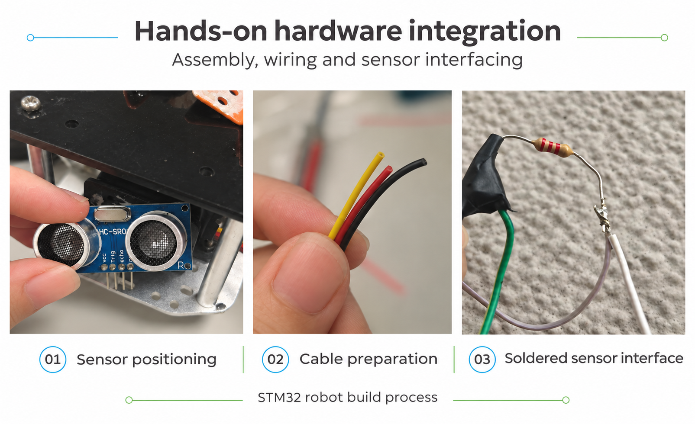

# STM32 Robot Bring-up & Sensor Calibration

**From board pinout to a working mobile robot.** Hands-on STM32CubeIDE configuration, sensor calibration, soldering, and steering/motor experiments on an STM32F407VET6 platform.

**Embedded C · STM32 HAL · GPIO / NVIC · Timers / PWM · ADC · UART · I²C**

This portfolio documents my work on the STM32 subsystem of an eight-person NTU Multidisciplinary Project. The platform combines two drive motors, steering servos, wheel encoders, infrared distance sensors, an HC-SR04 ultrasonic sensor, an IMU, and an OLED. My focus was the practical work connecting peripheral configuration, physical assembly, and bench observations.

## What I worked on

| My contribution | Evidence to explore |
|---|---|
| Configured the initial MCU pin assignments, NVIC settings, and timer prescalers in STM32CubeIDE | [Peripheral map and timer calculations](docs/peripheral-map.md) · [CubeMX configuration](firmware/mdp21_8.ioc) |
| Calibrated IR and ultrasonic sensing and inspected sensor readings | [Calibration data and reproducible analysis](analysis/README.md) · [IR implementation](firmware/Core/Src/sensors/ir_sensor.c) · [Ultrasonic test](firmware/Core/Src/tests/component/test_ultrasonic.c) |
| Soldered the ultrasonic interface resistors and IR sensor wires | [Assembly and debugging record](docs/bringup-and-debugging.md) |
| Recorded and tuned servo pulse widths and motor PWM parameters | [Servo and PWM experiments](docs/servo-and-pwm.md) · [Shared tuning constants](firmware/Core/Inc/drivers/robot_tuning.h) |

The wider firmware includes encoder and IMU feedback and motion-command integration. Those modules provide project context; this showcase identifies my contributions in configuration, calibration, assembly, and tuning.

## Hardware on the bench

AI-assisted annotations are presentation aids derived from my build photos. The originals are the authoritative photographic evidence; callouts are not physical measurements.

Original build photographs

- [Assembled robot: controller, wiring, motors and steering](assets/originals/stm32-overview.jpg)
- [HC-SR04 placement on the chassis](assets/originals/sensor-mount.jpg)
- [Soldered sensor interface close-up](assets/originals/soldered-interface.jpg)
- [Cable preparation](assets/originals/cable-preparation.jpg)

## Calibration with recorded data

The IR record contains **60 historical captures: two sensors, ten target distances and three captures per point**. The [analysis folder](analysis/README.md) preserves the raw ADC/millivolt readings and reproduces this chart with Python.

The selected source uses independent lookup tables and piecewise linear interpolation: 10–50 cm on the left and 10–60 cm on the right. The historical chart is separate from those later source tables; it neither generates their constants nor validates distance accuracy.

## A few implementation details

- **Clock and timing:** HSI at 16 MHz with PLL disabled; timer prescalers are calculated for that configuration. Motor PWM is approximately 2.22 kHz; servo PWM is 50 Hz with a 1 μs counter step.
- **Sensor acquisition:** dual-channel ADC for IR; both-edge TIM8 input capture for ultrasonic echo duration, with UART/OLED component diagnostics.
- **Serial and IMU interfaces:** USART3 at 115200 8-N-1; I2C2 at 100 kHz. The configuration notes describe the Raspberry Pi command link and onboard ICM20948 interface.
- **Version history matters:** earlier notes use PC7/PC6 for ultrasonic sensing; the selected snapshot uses PB15/PC8. Servo centre candidates also changed during tuning. [Details](docs/peripheral-map.md#configuration-stages).

## Repository guide

| Directory | Contents |
|---|---|
| [`docs/`](docs/peripheral-map.md) | Pin map, bring-up process, debugging and tuning notes |
| [`analysis/`](analysis/README.md) | Supplied IR measurements, analysis script and generated outputs |
| [`firmware/`](firmware/README.md) | Selected original source/configuration files with a SHA-256 manifest |
| `assets/` | Annotated overview, calibration chart and original build photos |

The firmware directory contains selected source evidence. See its [scope and verification notes](firmware/README.md) and [source provenance](THIRD_PARTY_NOTICES.md).
