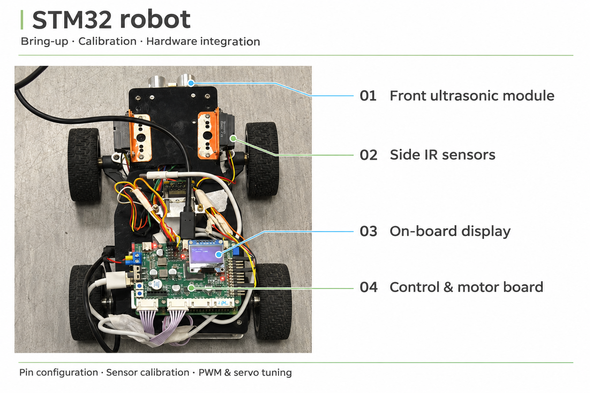
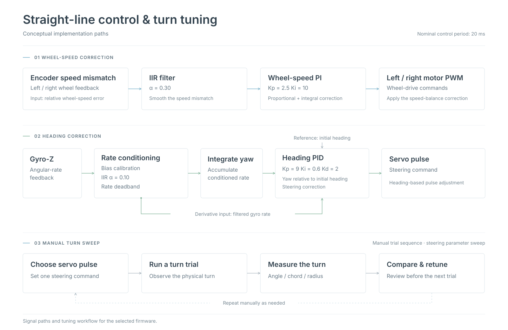
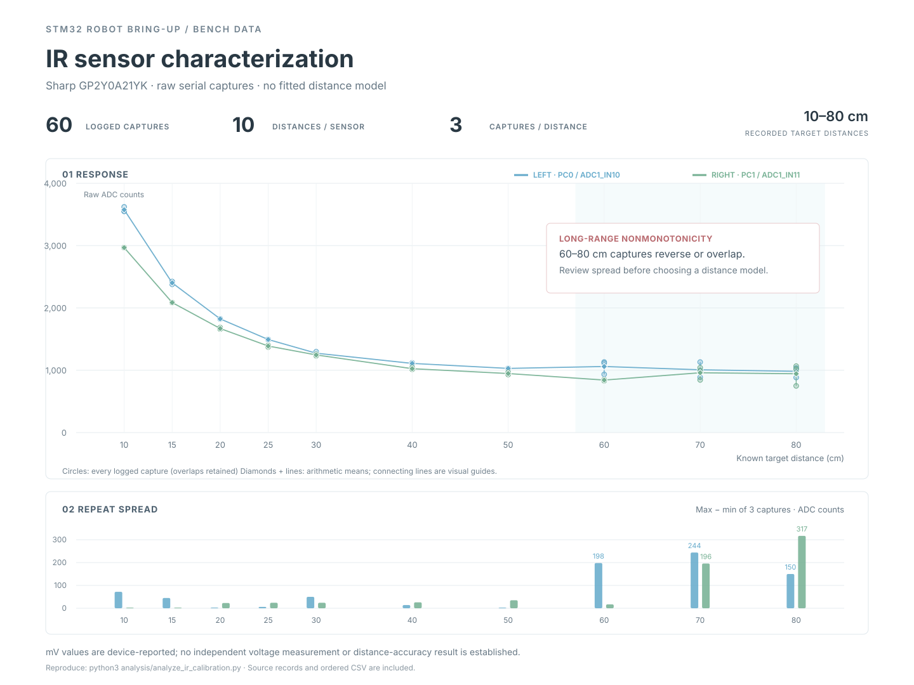

# STM32 Robot Bring-up & Sensor Calibration

**From board pinout to a working mobile robot.** Hands-on STM32CubeIDE configuration, closed-loop motion tuning, sensor calibration, soldering, and hardware integration on an STM32F407VET6 platform.

**Embedded C · STM32 HAL · PI / PID · Sensor filtering · Timers / PWM · ADC · UART · I²C**

This portfolio documents my work on the STM32 subsystem of an eight-person NTU Multidisciplinary Project. The platform combines two drive motors, steering servos, wheel encoders, infrared distance sensors, an HC-SR04 ultrasonic sensor, an IMU, and an OLED. My work connected peripheral configuration and physical assembly with sensor measurements, straight-line control, and turning experiments.

## What I worked on

| My contribution | Evidence to explore |
|---|---|
| Configured the initial MCU pin assignments, NVIC settings, and timer prescalers in STM32CubeIDE | [Peripheral map and timer calculations](docs/peripheral-map.md) · [CubeMX configuration](firmware/mdp21_8.ioc) |
| Calibrated IR and ultrasonic sensing and inspected sensor readings | [Calibration data and reproducible analysis](analysis/README.md) · [IR implementation](firmware/Core/Src/sensors/ir_sensor.c) · [Ultrasonic test](firmware/Core/Src/tests/component/test_ultrasonic.c) |
| Soldered the ultrasonic interface resistors and IR sensor wires | [Assembly and debugging record](docs/bringup-and-debugging.md) |
| Recorded and tuned servo pulse widths and motor PWM parameters | [Servo and PWM experiments](docs/servo-and-pwm.md) · [Shared tuning constants](firmware/Core/Inc/drivers/robot_tuning.h) |
| Tuned wheel-speed PI, gyro-heading PID, and encoder/gyro filtering for straight-line motion | [Motion-control tuning](docs/motion-control-tuning.md) · [Straight controller](firmware/Core/Src/control/straight_control.c) |
| Performed steering PWM sweeps and turn-calibration trials | [Turning experiments](docs/motion-control-tuning.md) · [Turn controller](firmware/Core/Src/control/turn_control.c) |

My contribution spans configuration, assembly, calibration, and motion-control tuning within the team robot project. The selected source files make the hardware interfaces and experiment routines inspectable.

## Motion-control tuning

### Straight-line PI/PID and filtering

I tuned two feedback paths: **wheel-speed PI** balances left/right motor PWM from encoder movement, while **gyro-based heading PID** adjusts the steering servo relative to the initial heading. Debugging separated wheel mismatch, steering-centre alignment, and gyro drift; matching wheel travel alone did not guarantee a straight chassis path.

The selected implementation uses a nominal **20 ms control period**, IIR filtering on encoder mismatch and gyro readings, stationary gyro-bias calibration, deadbands, and integral/output limits. I adjusted the control gains and filtering while checking drift, steering response, and wheel behaviour. Filter coefficients and PI/PID gains are documented separately in the [tuning record](docs/motion-control-tuning.md).

### Turning parameter sweeps

I stepped through steering PWM settings, recorded the servo's useful response range, and ran turning trials while adjusting motor PWM, steering/radius settings, and stopping behaviour. The selected routines include a **180° minimum-radius trial** and **90° forward/back-out cases**, with UART output and instructions for measuring physical chassis angle and endpoint chord length.

The [experiment notes](docs/motion-control-tuning.md) connect these manual sweeps to the source and distinguish recorded observations from configured thresholds. The illustration summarizes the selected control paths and experiment workflow.

## Hardware on the bench

AI-assisted annotations are presentation aids derived from my build photos. The originals are the authoritative photographic evidence; callouts are not physical measurements.

Original build photographs

- [Assembled robot: controller, wiring, motors and steering](assets/originals/stm32-overview.jpg)
- [HC-SR04 placement on the chassis](assets/originals/sensor-mount.jpg)
- [Soldered sensor interface close-up](assets/originals/soldered-interface.jpg)
- [Cable preparation](assets/originals/cable-preparation.jpg)

## Calibration with recorded data

The IR record contains **60 historical captures: two sensors, ten target distances and three captures per point**. The [analysis folder](analysis/README.md) preserves the raw ADC/millivolt readings and reproduces this chart with Python.

The selected source uses independent lookup tables and piecewise linear interpolation: 10–50 cm on the left and 10–60 cm on the right. The historical chart is separate from those later source tables; it neither generates their constants nor validates distance accuracy.

## A few implementation details

- **Clock and timing:** HSI at 16 MHz with PLL disabled; timer prescalers are calculated for that configuration. Motor PWM is approximately 2.22 kHz; servo PWM is 50 Hz with a 1 μs counter step.
- **Sensor acquisition:** dual-channel ADC for IR; both-edge TIM8 input capture for ultrasonic echo duration, with UART/OLED component diagnostics.
- **Serial and IMU interfaces:** USART3 at 115200 8-N-1; I2C2 at 100 kHz. The configuration notes describe the Raspberry Pi command link and onboard ICM20948 interface.
- **Version history matters:** earlier notes use PC7/PC6 for ultrasonic sensing; the selected snapshot uses PB15/PC8. Servo centre candidates also changed during tuning. [Details](docs/peripheral-map.md#configuration-stages).

## Repository guide

| Directory | Contents |
|---|---|
| [`docs/`](docs/peripheral-map.md) | Pin map, bring-up process, debugging and tuning notes |
| [`analysis/`](analysis/README.md) | Supplied IR measurements, analysis script and generated outputs |
| [`firmware/`](firmware/README.md) | Selected original source/configuration files with a SHA-256 manifest |
| `assets/` | Annotated overview, calibration chart and original build photos |

The firmware directory contains selected source evidence. See its [scope and verification notes](firmware/README.md). Original source copyright and component license notices are retained in the firmware snapshot.
