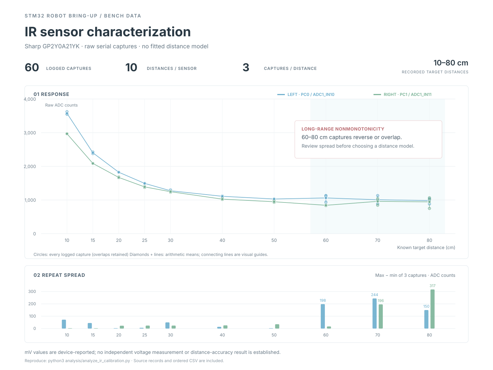

# IR sensor characterization



This analysis makes the recorded bench data inspectable: **60 serial captures, two Sharp GP2Y0A21YK sensors, ten distances per sensor and three captures per sensor/distance pair**. It preserves the recorded values, including duplicates and the long-range behavior that would be hidden by a smooth fitted curve.

## Dataset

The source is the `IR_CAL` section of the project's STM32 configuration note. The bundled [clean log](data/ir-calibration-log.txt) contains those 60 measurement records in their original order, without surrounding setup instructions or local file paths. It excludes command-error messages because they contain no measurement. Distances are **10, 15, 20, 25, 30, 40, 50, 60, 70 and 80 cm**; this follows the actual records, rather than the log's suggested-point list.

The note identifies left sensor output as **PC0 / ADC1_IN10** and right output as **PC1 / ADC1_IN11**, with 5 V sensor power and a common ground. The log states the motor switch was off. These are recorded setup details; no additional electrical measurements are inferred.

[Ordered captures](data/ir-calibration.csv) use these columns:

| Column | Meaning |
|---|---|
| `sample_order` | One-based position in the recorded sequence; no time spacing is inferred. |
| `sensor` | `L` or `R`, as reported. |
| `distance_cm` | Known target distance entered during capture. |
| `repeat_index` | First, second or third recorded capture for this sensor/distance pair. |
| `raw_adc` | Device-reported raw ADC value. |
| `reported_mv` | Device-reported millivolt value, preserved without recalculation. |

The first pass visits several distances before the remaining repeats are collected. The CSV retains that sequence rather than regrouping or interleaving the captures. Repeated identical values are retained as separate records.

## Observations

The two sensors have different responses. At 10 cm, the mean raw values are **3,575.33 left** and **2,968.00 right**. A shared conversion should therefore not be assumed from these data.

| Distance (cm) | Left mean ADC | Left max − min | Right mean ADC | Right max − min |
|---:|---:|---:|---:|---:|
| 10 | 3,575.33 | 72 | 2,968.00 | 2 |
| 15 | 2,402.33 | 45 | 2,086.33 | 1 |
| 20 | 1,824.33 | 3 | 1,669.67 | 23 |
| 25 | 1,493.33 | 6 | 1,388.67 | 24 |
| 30 | 1,273.67 | 50 | 1,245.67 | 24 |
| 40 | 1,109.67 | 14 | 1,025.00 | 26 |
| 50 | 1,029.67 | 2 | 947.33 | 35 |
| 60 | 1,060.33 | 198 | 842.33 | 17 |
| 70 | 1,007.33 | 244 | 959.67 | 196 |
| 80 | 982.67 | 150 | 943.67 | 317 |

The mean response is **nonmonotonic**: the left mean rises by **30.67 ADC counts from 50 to 60 cm**, and the right mean rises by **117.33 counts from 60 to 70 cm**. Long-range repeat spread is also visible: the right 80 cm captures are **749, 1,066 and 1,016**, a **317-count range**. The left 70 cm range is **244 counts**. These are observations in this log; the data do not establish the cause.

The figure plots all 60 captures at their recorded distances. Coincident readings overlap. Diamonds show arithmetic means, and straight connecting segments are visual guides rather than a fitted model. The lower panel shows the range of the three captures at each point. [The summary CSV](data/ir-summary.csv) also includes sample standard deviation (`n − 1`, with `n = 3`), minimum, maximum and mean reported mV. These descriptive statistics are not a confidence interval or a distance-error estimate.

## Reproduce

Python 3.9+ and its standard library are sufficient. Run from the repository root:

```bash
python3 analysis/analyze_ir_calibration.py
```

The script regenerates the clean log, ordered CSV, summary CSV and `assets/ir-calibration.svg`. It checks for exactly 60 records, both sensors, all ten expected distances, exactly three captures per pair and valid 12-bit ADC values. It also verifies that CSV serialization preserves every parsed value and its order. A malformed `IR_CAL` line causes a failure instead of a partial extraction.

To re-extract from another copy of the original note, pass its text file explicitly:

```bash
python3 analysis/analyze_ir_calibration.py --source path/to/configuration-note.txt
```

The included PNG is a raster preview of the SVG; the dependency-free reproduction target is the SVG. No plotting packages or network access are required.

## Limits and next experiment

- The three entries per point are logged captures, not proven independent tests. Their internal sampling/averaging method and timestamps are not included.
- Millivolts are **device-reported**, not an independent multimeter or oscilloscope measurement. ADC reference voltage, voltage-conversion method and instrument uncertainty are not established by the excerpt.
- Target material, ambient conditions, placement tolerance and supply stability are not recorded in sufficient detail to explain the long-range spread.
- There is no held-out validation set, distance prediction, fitted conversion, uncertainty bound or calibrated-accuracy claim in this analysis. A later note's statement that sensors were calibrated is not evidence that this particular capture set yields a validated model.
- A useful next experiment would repeat each sensor's sweep under controlled target geometry and power conditions, log capture times and reference voltage, then evaluate any proposed conversion against separate measured-distance trials.
