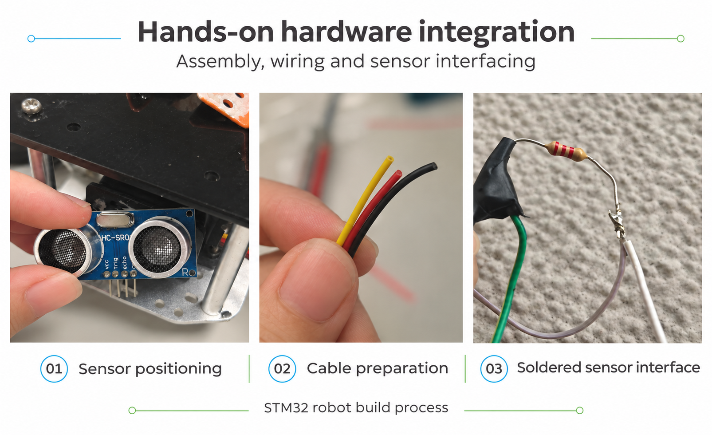
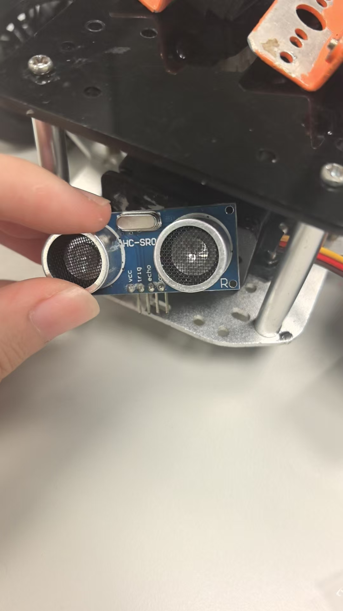

# Bring-up, Calibration and Connection Work

My contribution covered the physical and firmware interfaces: pin setup, NVIC/prescalers, sensor calibration, ultrasonic resistor soldering and IR wire soldering. These records show how I worked between the board, wiring and sensor readings.

## Physical integration



The AI-assisted annotated panels are presentation aids derived from the original photos. They identify construction steps and components; they are not evidence of a physical measurement or quantitative outcome. Original photos remain the authoritative photographic record and are linked alongside the panels.



The HC-SR04 was fitted at the front of the chassis. Its echo interface uses a resistor divider before the STM32 input. I soldered the ultrasonic resistors and IR sensor wires, and prepared the cable connections used during integration.

[Original soldered-interface close-up](../assets/originals/soldered-interface.jpg)

The photos preserve the actual prototype work, including exposed soldered connections during assembly. The source describes a 5V-to-3.3V echo divider. The available records do not establish measured resistor values for every build version.

## IR: from readings to a usable distance estimate

The left and right Sharp sensors are connected to PC0/PC1, with independent ADC conversion tables. The calibration workflow recorded target distance, ADC raw value and millivolts for each side. The supplied historical log contains 60 captures across two sensors and ten distances, with three captures per sensor/distance pair. Its values are separate from the later firmware lookup tables and are not presented as the data that generated those tables.

The calibration utility accepts:

```text
L,20     capture left sensor at a known 20 cm distance
R,20     capture right sensor at a known 20 cm distance
B,30     capture both sensors at a known 30 cm distance
LIVE     inspect sensor readings continuously
```

The selected calibration utility averages 64 ADC scans per capture; the historical log does not establish whether it used this exact utility version. The current conversion module uses piecewise interpolation and explicit near/far status handling. Its left table spans 10–50 cm and its right table 10–60 cm. Current table entries and historical log readings are separately identified in the [analysis record](../analysis/README.md).

During troubleshooting I checked sensor power, ground, signal wiring, pin assignments and calibration, and resoldered the IR connection. The source records a “repaired-wire calibration” for the left sensor. This is a concrete example of debugging across the physical connection and ADC measurements; no numerical improvement is inferred from the photograph alone.

Review: [IR source](../firmware/Core/Src/sensors/ir_sensor.c) · [calibration utility](../firmware/Core/Src/tests/calibration/test_ir_calibration.c) · [recorded measurements](../analysis/README.md).

## Ultrasonic: verify the timing path

The selected implementation sends a 10 μs trigger on PB15 and captures both echo edges on PC8/TIM8_CH3. With a 1 MHz timer counter:

```text
echo duration in μs → distance ≈ echo_us × 0.0343 / 2 cm
```

The component test exposes pulse duration and calculated distance over UART/OLED, with separate no-echo and out-of-range outcomes. The implementation handles 16-bit counter wrap, uses a 60 ms timeout and marks pulses over 25000 μs invalid. These are implementation settings, rather than measured accuracy or reliability results.

My work included ultrasonic calibration and the physical resistor interface. The available portfolio records do not contain a repeated known-distance ultrasonic error table, so the evidence presented here is the setup, measurement path and component work.

The interrupt review path is `TIM8_CC_IRQHandler` → `HAL_TIM_IRQHandler` → `HAL_TIM_IC_CaptureCallback`. When readings are absent, that path connects the selected pin alternate function, NVIC enable/priority, timer configuration and physical return signal. Earlier notes used PC7/PC6; see the [versioned pin map](peripheral-map.md#configuration-stages).

Review: [ultrasonic component test](../firmware/Core/Src/tests/component/test_ultrasonic.c) · [shared sensor module](../firmware/Core/Src/sensors/ultrasonic_sensor.c).

## Keeping observations separate from targets

The configuration note is headed 21 August 2026 and combines initial setup with later, undated tuning sections. It contains completed checks, measured observations and future test plans. For example, the specified ±6% distance tolerance is an assessment requirement, not a reported achieved accuracy. Raspberry Pi integration, full assessment testing and recommendations headed “Need to try” are preserved as development context rather than passed results.

A useful follow-up measurement record includes the configuration version, commanded input, physical reference, raw readings, repeated trials and battery/floor conditions. New accuracy claims should be based on that record.
